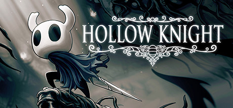

**Hollow Knight by Team Cherry (2017) is a hand-drawn metroidvania set in the underground kingdom of Hallownest.**

---

## 📖 About

Hollow Knight by Team Cherry (2017) is a hand-drawn metroidvania set in the underground kingdom of Hallownest. The game features 40+ hours of content, multiple secret endings, and some of the hardest optional boss fights in the genre including the Pantheon of Hallownest.

## ⚠️ Problems Without Trainer

| Problem | Status |
|---------|--------|
| Geo loss on death removes all currency forcing repeat of difficult sections | ✅ Solved |
| Pantheon of Hallownest requires 45-minute flawless gauntlet completion | ✅ Solved |
| Pale Ore upgrades for nail locked behind extremely hard optional bosses | ✅ Solved |
| Charm notch system forces painful tradeoffs that invalidate entire builds | ✅ Solved |
| Lost Kin and Soul Master dream bosses gate story progress with hard fights | ✅ Solved |

## ✅ Solution

The **Hollow Knight Trainer** solves all these issues, giving you complete control so you can focus on enjoying the game.

## 🎯 Features

- Unlimited Resources / Currency
- God Mode / Invincibility
- Instant Skill & Ability Cooldown
- One-Hit Kill
- Freeze Timers
- Unlock All Items & Achievements
- Custom Speed Multiplier
- Infinite Stamina / Energy

## 🚀 Quick Start

1. **Disable Windows Defender** temporarily (trainer may trigger false positive)
2. Get the trainer from the button above
3. Launch Hollow Knight
4. Run the trainer as Administrator
5. Use the hotkeys to activate cheats in-game

## 💎 Free vs Pro

| Feature | Free | Pro |
|---------|------|-----|
| God Mode | ✅ | ✅ |
| Unlimited Resources | ✅ | ✅ |
| Advanced Cheats | ❌ | ✅ |
| Auto-Updates | ❌ | ✅ |
| Priority Support | ❌ | ✅ |

## 💻 Requirements

- Windows 10 / 11 (64-bit)
- Hollow Knight (any version)
- .NET Framework 4.8+
- DirectX 11+

## 🍎 macOS

## ⚖️ Legal

Educational and single-player use only.

---

